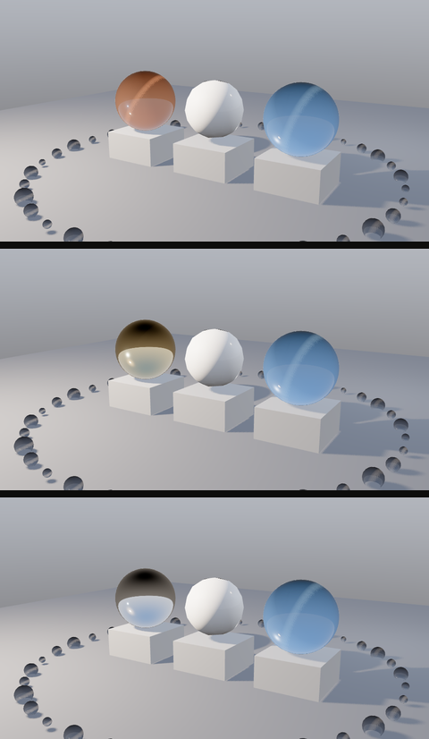
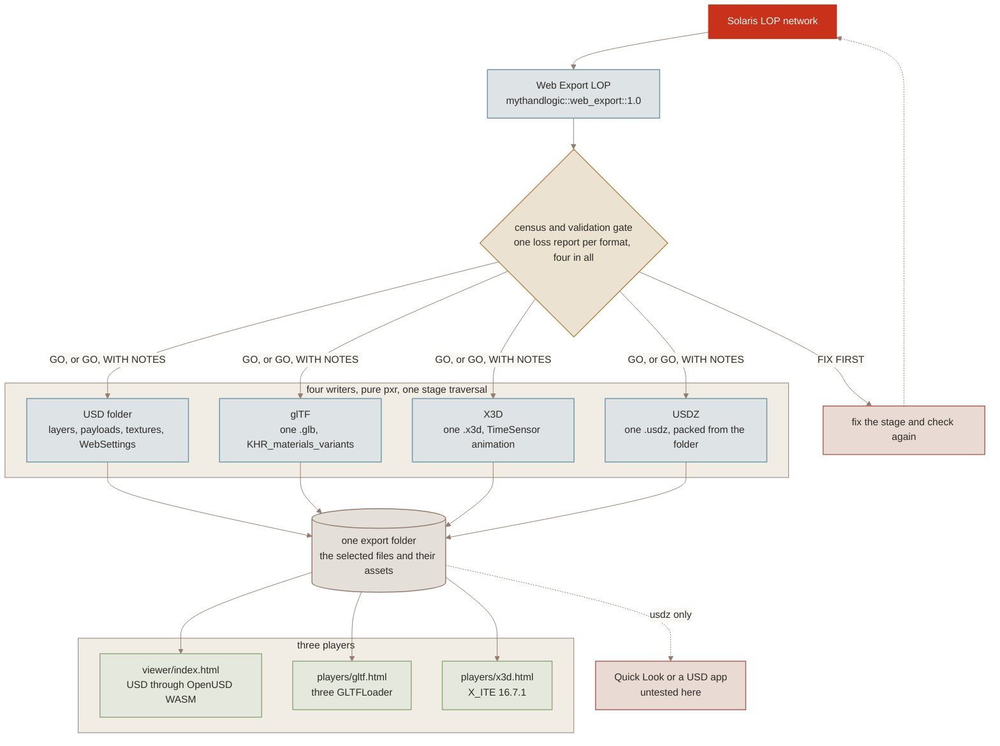
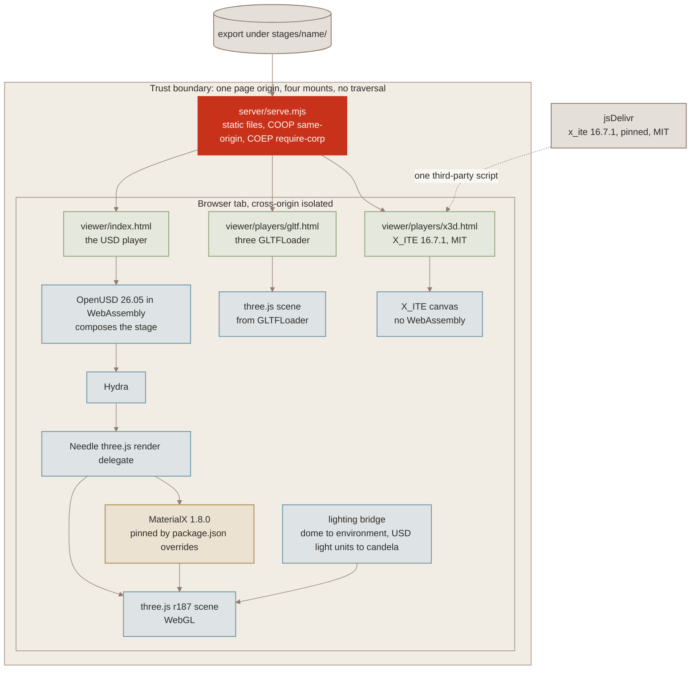

<picture>
  <source media="(prefers-color-scheme: dark)" srcset="docs/assets/logo-lockup-dark.png">
  <source media="(prefers-color-scheme: light)" srcset="docs/assets/logo-lockup-light.png">
  
</picture>

Publish Houdini Solaris output on the web. One node writes four formats, and real OpenUSD composes the USD stage inside a browser tab while three.js r187 draws it as a Hydra render delegate, the same way Karma does in Houdini.

Reading path: read Status to Quickstart first, seven sections and about four minutes, then run the viewer; the rest is reference, about seven minutes more, for when your own export is ready.

---

###  Status

Version 0.7.0. One LOP node, `mythandlogic::web_export::1.0`, writes four formats from the end of a Solaris network: USD Folder, glTF (`.glb`), X3D (`.x3d`) and USDZ (`.usdz`). The USD folder opens in the viewer through OpenUSD in WebAssembly, and the `.glb` and `.x3d` each have their own player. It has run on Joe's RTX 4090 under Windows (T02, see [CHANGELOG 0.1.2](CHANGELOG.md)). Checking a real Karma export (T03) is still open, and Quick Look itself is untested here. The Needle runtime is PolyForm Noncommercial, so it is for **local evaluation only**.

---

###  See it first

<a href="docs/media/explainer.mp4"></a>

Select the poster to open the explainer video.



The still is the fixture stage in the browser: one asset, three look variants switched live.

---

###  The idea

**three.js becomes another Hydra render delegate.** A Solaris network produces a USD stage, and Houdini's renderers read that stage through Hydra. Needle compiled OpenUSD 26.05 to WebAssembly and wrote a Hydra delegate that outputs three.js objects. So the browser runs the same composition engine Houdini does: payloads, variants, purpose and instancing are resolved by USD itself, not guessed by a converter.

In plain words, Hydra works like a lens mount. Karma is one lens on it, and this project makes three.js another lens on the same mount, inside a browser tab. The camera body, your USD stage, stays the same, so nothing has to convert your scene before the browser can show it.

---

###  Four formats from one node

**One loss report per format comes before any write.** The node reads the composed stage once and builds the report for every selected format. A blocking item in one format's report means that format writes nothing, while the others still write. Every selected file lands in the same export folder: USD layers and textures, one `.glb`, one `.x3d` and one `.usdz`.

| Format | What the file keeps | Where to open it |
|:---|:---|:---|
| USD Folder | The root layer, payloads, references and textures, relative paths, and `/WebSettings` | `viewer/index.html`, through OpenUSD 26.05 in WebAssembly and the Hydra delegate |
| glTF (`.glb`) | Meshes, PBR materials, embedded PNG and JPEG textures, a camera, punctual lights, `EXT_mesh_gpu_instancing`, `KHR_materials_variants`, and LINEAR animation samplers | `viewer/players/gltf.html`, three's `GLTFLoader` |
| X3D (`.x3d`) | `Transform`, `Shape` and `IndexedFaceSet`, `PhysicalMaterial`, a `Switch` per look, `DEF`/`USE` instancing, and a `TimeSensor` with interpolators and `ROUTE` | `viewer/players/x3d.html`, X_ITE 16.7.1 |
| USDZ (`.usdz`) | The USD folder packed into one archive by `UsdUtils.CreateNewUsdzPackage`, with composition, variants, instancing and subdivision intact | Quick Look or another USD app; Quick Look is untested here |

The glTF writer is a recorded decision, not a default. It is pure Python on `pxr`, because Houdini's own glTF output cannot take a LOP stage without flattening it first. The record is [docs/decisions/0001-gltf-writer.md](docs/decisions/0001-gltf-writer.md).

---

###  Animation and looks travel with the files

**The glTF writer samples every timecode.** A moving node's local-to-world becomes LINEAR samplers, one per channel, with times in seconds. The X3D writer bakes the same motion as a `TimeSensor`, an `OrientationInterpolator` or `PositionInterpolator`, and the `ROUTE` statements that wire them. USDZ inherits the stage, so the animation is already in the archive.

The glTF writer also encodes `KHR_materials_variants`, so the fixture's chrome, ember and gold looks travel in one file. X3D keeps the same looks in a `Switch` with one group per look, which costs file size but keeps them switchable.

---

###  Two small pieces close the gaps

A lighting bridge turns the dome light into an environment map and converts USD light units into three.js units. It reads `DomeLight_1`, the schema Houdini 22's Dome Light LOP writes, as well as the older `DomeLight`, and it orients the dome by its transform and its `poleAxis`.

A **web census** checks an export before you open it, and tells you in one word whether it will load. It also catches any file outside the export folder, which loads in Houdini and 404s in the browser.

In plain words, the census is a pilot's walk-around before take-off. It reads your export the way the browser will and flags what only works on your workstation, such as a `.rat` texture or a `../` path, so you find out at your desk rather than from a grey material or a 404 on the web.

---

###  Quickstart

You need Node 22 or newer and a desktop Chrome or Edge.

```
git clone https://github.com/JosephOIbrahim/Solaris-to-Three.js.git
cd Solaris-to-Three.js
npm ci
npm start
```

Open http://127.0.0.1:5180. The status line reports the three.js version, whether the page is cross-origin isolated and how long each stage took.

| URL | What you get |
|:---|:---|
| `/` | The fixture stage on three r187 with MaterialX 1.8.0 |
| `/?three=185` | The same page on three r185, for comparison |
| `/?clean` | Hides the HUD and status line, for screenshots |
| `/?stage=/stages/<name>/<root>.usda` | Your own export, from `stages/<name>/` |
| `/players/gltf.html` | The fixture as a `.glb`, drawn by three's `GLTFLoader` |
| `/players/x3d.html` | The fixture as a `.x3d`, drawn by X_ITE 16.7.1 |

---

###  Your own Solaris export

**Start inside the node.** Add the Web Export LOP at the end of the Solaris network, set Output Folder, and tick the formats. Check reads the composed stage and fills Report. Export writes only when nothing blocks. Preview starts the server and opens the USD folder in the viewer. The card is [docs/web-export.md](docs/web-export.md).

The manual route works without the node.

01. On the USD ROP, write the root layer, payloads and textures into one folder with relative paths. The settings and output processors are in [docs/export.md](docs/export.md).

02. Check it: `hython tools/web_census.py <folder>/<root>.usda`. Fix anything under `FIX FIRST`. The card is [docs/census.md](docs/census.md).

03. Copy the folder to `stages/<name>/`. Everything in `stages/` except the placeholder is git-ignored, so client work never lands in the repo.

04. Open `/?stage=/stages/<name>/<root>.usda` and read the status line. It names every prim whose material fell back to the grey default.

The two standalone players take the exported files the same way: `/players/gltf.html?model=/stages/<name>/<root>.glb` and `/players/x3d.html?model=/stages/<name>/<root>.x3d`.

---

###  The export pipeline



**The report is the gate.** The node builds one loss report per selected format from the same stage traversal. A blocking item writes nothing for that format, and the other formats still write. The four writers are pure Python on `pxr`, so the core runs in CI without Houdini.

One folder is the hand-off. The selected files and their assets sit together under the export folder, and the players read from `stages/`.

---

###  The browser runtime

The browser side has one boundary: the server, the isolated tab and the three players.



**The server matters more than it looks.** The OpenUSD build is threaded and needs `SharedArrayBuffer`, which browsers only allow on a page sent with `Cross-Origin-Opener-Policy: same-origin` and `Cross-Origin-Embedder-Policy: require-corp`. Those two headers make the page cross-origin isolated, and any host you deploy to must send both.

In plain words, the two headers are a clean-room seal. The runtime's threads share one workbench of memory, and a browser only allows a shared workbench in a page that has sealed itself off from other sites. Without the seal, the runtime refuses to start, and the page tells you it is not cross-origin isolated.

The browser runs three players on one server: the USD viewer through OpenUSD and Hydra, the glTF player through three's `GLTFLoader`, and the X3D player through X_ITE. The full walk-through, from the import map to the lighting bridge, is in [docs/architecture.md](docs/architecture.md).

---

###  Tools

**Start here:** `tools/web_census.py` for every export, `tools/build_router.py` when you plan the next tasks, and `tools/release.py` when you ship a version.

| Tool | What it answers | Needs |
|:---|:---|:---|
| `tools/web_census.py` | Can this export go to the web? | `pxr`: hython, or `pip install usd-core` |
| `houdini/otls/web_export.hda` | The Web Export LOP: the loss report and four formats from inside Solaris. See [docs/web-export.md](docs/web-export.md). | Houdini 22 with the package installed |
| `scripts/build_hda.py` | Rebuilds the Web Export HDA from source. | hython 22.0.400 |
| `tools/build_router.py` | Which build tasks run in a cloud agent, at the desk, or as Joe's decision? See [docs/router.md](docs/router.md). | Python 3 |
| `tools/release.py` | Is this version ready to release? It checks, then creates the GitHub release. The loop is in [docs/workflow.md](docs/workflow.md). | Python 3, git, a signed-in `gh` |
| `tools/jev.py` | The shared door to TypeSafe's Jev, used by the census and the router. Standard library only; fails open. | Python 3 |
| `tools/make_stage.py` | Rebuilds the Solaris-shaped fixture stage | `pxr`, `numpy` |
| `tools/make_gltf_fixture.py` | Rebuilds `fixtures/stage-flat/hero.glb` through the real glTF writer | `pxr` |
| `tools/make_x3d_fixture.py` | Rebuilds `fixtures/stage-flat/hero.x3d` through the real X3D writer | `pxr` |
| `tools/make_animated_stage.py` | Rebuilds the animated fixture: one cube that turns a full circle over 121 frames | `pxr` |
| `tools/make_dirty_stage.py` | Rebuilds the fixture with eight planted problems | `pxr` |
| `tools/make_escape_stage.py` | Rebuilds the fixture that points outside its export folder | `pxr` |
| `tools/make_websettings_stage.py` | Rebuilds the fixture whose `/WebSettings` sets a title and hides the HUD | `pxr` |
| `tools/decide.py` | Can an agent settle this design choice, or does it go to Joe? Jev judges, code decides ADOPT or ASK JOE. See [docs/router.md](docs/router.md). | Python 3 |

Jev is optional everywhere. Set `TYPESAFE_API_KEY` in your environment to turn it on; without it, the census and the router still run and say so, and `decide.py` sends every decision to Joe.

---

###  Repo map

**Start here:** `viewer/main.js` for the viewer, `server/serve.mjs` for the headers, and `stages/` for your own exports.

<details>
<summary>The full map, 24 entries</summary>

```
server/serve.mjs          static server: COOP/COEP headers, four mounts, no traversal
viewer/index.html         import map (no bundler), the HUD and the USD player
viewer/main.js            Hydra route, USDLoader route, lighting bridge, USD camera, variants
viewer/players/gltf.html  the glTF player: three's GLTFLoader, no Needle packages
viewer/players/x3d.html   the X3D player: X_ITE 16.7.1 from jsDelivr
tools/                    census, router, decisions, Jev client, fixture builders
python/webexport/         Web Export core (pure pxr): api, report, settings, inventory
python/webexport/profiles/  one profile per format: what it can and cannot carry
python/webexport/writers/   one writer per format: USD folder, glTF, X3D, USDZ
packages/                 the Houdini package file for Web Export
scripts/                  install_package.py and build_hda.py: deploy the package, rebuild the HDA
houdini/                  HOUDINI_PATH root for the Web Export package
houdini/otls/web_export.hda  the Web Export LOP asset (File IO/Export), built by scripts/build_hda.py
fixtures/stage/           Solaris-shaped test stage: shot.usda, hero/asset.usda, env/sky.hdr
fixtures/stage-flat/      the same asset as .glb, .x3d and .usdz, for the players and the census
fixtures/stage-animated/  one cube that turns a full circle over 121 frames, for animation
fixtures/stage-dirty/     a stage with eight planted problems, for the census
fixtures/stage-escape/    an export that points outside its own folder, for the census
stages/                   your exports go here (git-ignored)
plan/                     roadmap tasks, the Web Export blueprint and its wave tasks, recorded decisions
tests/                    Python unit tests and a local Jev stand-in
tests/browser/            headless Chromium smoke test and screenshots
docs/                     architecture, versions, lighting, gotchas, operator's cards, brand assets
docs/decisions/           the design records, starting with the glTF writer route
```

</details>

---

###  Testing

`npm test` runs the syntax checks and the Python unit tests. The census tests need `pxr` and skip themselves without it; the router tests need only Python. Jev is tested against a local stand-in that speaks TypeSafe's documented response shapes, so no key is needed and nothing leaves the machine.

The viewer works end to end on a synthetic Solaris-shaped stage in headless Chromium. The 18 browser checks include both players and the exported fixtures, and the X3D output is checked against the official X3D 4.0 schema. `npm run test:browser` opens the pages, exercises every feature, saves screenshots to `shots/` and fails if the page errors, a material falls back or a route doesn't load. **Start the server first**, and install Playwright with Chromium (`npm i --no-save playwright && npx playwright install chromium`).

CI runs the unit tests and syntax checks on every push and pull request. The browser test runs on demand from the Actions tab, because software rendering takes several minutes.

---

###  Versions

**The one pin that matters is MaterialX.** `@needle-tools/usd` 1.1.2 asks for MaterialX 1.7.3, which breaks on three r186 and later, so `package.json` forces 1.8.0. The full matrix and when to recheck it are in [docs/versions.md](docs/versions.md).

---

###  Licensing

Read this before you put it in front of a client.

This repository's own code is MIT-licensed; see [LICENSE](LICENSE). Copyright (c) 2026 Joseph O. Ibrahim.

The MIT licence covers this repo's code only. `@needle-tools/usd` and `@needle-tools/materialx` are licensed **PolyForm Noncommercial 1.0.0**. They are installed from npm, not redistributed here. Use them for local evaluation only until Needle grants commercial terms (hi@needle.tools). three.js is MIT. OpenUSD is under its own licence. X_ITE is MIT and loaded from jsDelivr.

---

###  Roadmap

| Plan | What it holds |
|:---|:---|
| [`plan/web-export-blueprint.md`](plan/web-export-blueprint.md) | The design record behind the node. Its first milestones are built, and section 6 says what was proven and what stays open. |
| [`plan/tasks.json`](plan/tasks.json) | The 16 roadmap tasks, from the first run on a real GPU to a live Solaris viewport. Run `npm run route` to see which ones a cloud agent can take and which need a person. |
| Qt report panel | Planned. A panel that renders each format's loss report side by side. |
| Synapse tool | Planned. An optional tool in the Synapse repo that calls `webexport.api.export` when this package is present. |

Known traps and open gaps are in [docs/gotchas.md](docs/gotchas.md), and every release is in [CHANGELOG.md](CHANGELOG.md).

---

Solaris builds the stage, the Web Export node writes four files, and real OpenUSD composes the USD one in a browser tab while three.js draws it as one more Hydra render delegate, so no converter guesses at your scene on the way to the web.
