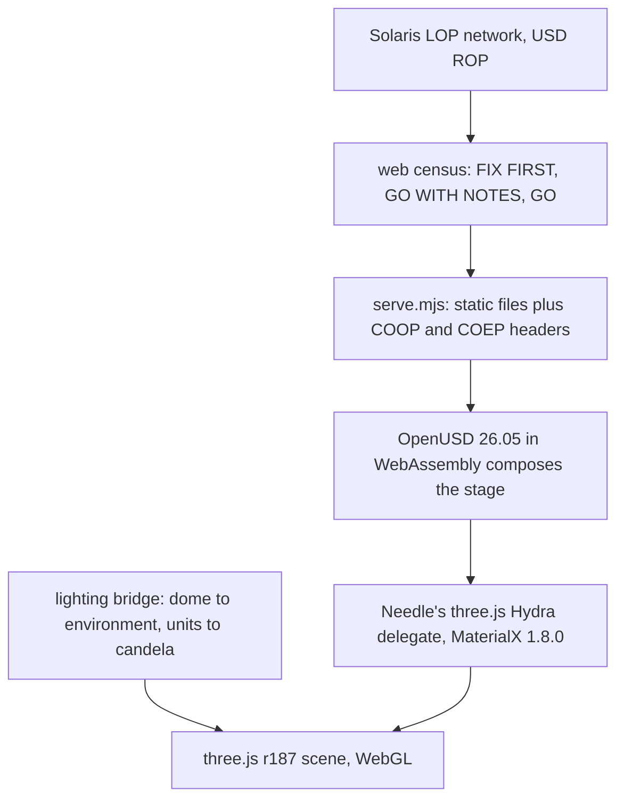

# Solaris to three.js

Publish Houdini Solaris output on the web. Real OpenUSD composes your stage inside a browser tab, and three.js r187 draws it as a Hydra render delegate, the same way Karma does in Houdini.


> **Status: 0.1.0, local evaluation.** It works end to end on a synthetic Solaris-shaped stage in headless Chromium. It has not yet met a real GPU, Windows or a real Karma export. The OpenUSD runtime it depends on is licensed for noncommercial use only; read [Licensing](#licensing) before you put it in front of a client.

## The idea

**three.js becomes another Hydra render delegate.** A Solaris network produces a USD stage, and Houdini's renderers read that stage through Hydra. Needle compiled OpenUSD 26.05 to WebAssembly and wrote a Hydra delegate that outputs three.js objects. So the browser runs the same composition engine Houdini does: payloads, variants, purpose and instancing are resolved by USD itself, not guessed by a converter.

Two small pieces close the gaps. A **lighting bridge** turns the dome light into an environment map and converts USD light units into three.js units. A **web census** checks an export before you open it, and tells you in one word whether it will load.

The full walk-through is in [docs/architecture.md](docs/architecture.md).

## Quickstart

You need Node 22 or newer and a desktop Chrome or Edge.

```
git clone https://github.com/JosephOIbrahim/Solaris-to-Three.js.git
cd Solaris-to-Three.js
npm ci
npm start
```

Open http://127.0.0.1:5180. The status line reports the three.js version, whether the page is cross-origin isolated and how long each stage took.

| URL | What you get |
|---|---|
| `/` | The fixture stage on three r187 with MaterialX 1.8.0 |
| `/?three=185` | The same page on three r185, for comparison |
| `/?clean` | Hides the HUD and status line, for screenshots |
| `/?stage=/stages/<name>/<root>.usda` | Your own export, from `stages/<name>/` |

## Your own Solaris export

1. On the USD ROP, write the root layer, payloads and textures into one folder with relative paths.
2. Check it: `hython tools/web_census.py <folder>/<root>.usda`. Fix anything under **FIX FIRST**. The card is [docs/census.md](docs/census.md).
3. Copy the folder to `stages/<name>/`. Everything in `stages/` except the placeholder is git-ignored, so client work never lands in the repo.
4. Open `/?stage=/stages/<name>/<root>.usda` and read the status line. It names every prim whose material fell back to the grey default.

## How it works



The server matters more than it looks. The OpenUSD build is threaded and needs `SharedArrayBuffer`, which browsers only allow on a page sent with `Cross-Origin-Opener-Policy: same-origin` and `Cross-Origin-Embedder-Policy: require-corp`. Any host you deploy to must send both.

## Tools

| Tool | What it answers | Needs |
|---|---|---|
| `tools/web_census.py` | Can this export go to the web? | `pxr`: hython, or `pip install usd-core` |
| `tools/build_router.py` | Which build tasks run in a cloud agent, at the desk, or as Joe's decision? See [docs/router.md](docs/router.md). | Python 3 |
| `tools/release.py` | Is this version ready to release? It checks, then creates the GitHub release. The loop is in [docs/workflow.md](docs/workflow.md). | Python 3, git, a signed-in `gh` |
| `tools/jev.py` | The shared door to TypeSafe's Jev, used by both tools above. Standard library only; fails open. | Python 3 |
| `tools/make_stage.py` | Rebuilds the Solaris-shaped fixture stage | `pxr`, `numpy` |
| `tools/make_dirty_stage.py` | Rebuilds the fixture with eight planted problems | `pxr` |

Jev is optional everywhere. Set `TYPESAFE_API_KEY` in your environment to turn it on; without it, both tools still run and say so.

## Repo map

```
server/serve.mjs          static server: COOP/COEP headers, four mounts, no traversal
viewer/index.html         import map (no bundler) and the HUD
viewer/main.js            Hydra route, USDLoader route, lighting bridge, USD camera, variants
tools/                    census, router, Jev client, fixture builders
fixtures/stage/           Solaris-shaped test stage: shot.usda, hero/asset.usda, env/sky.hdr
fixtures/stage-flat/      the same asset flattened to .usdz for three's own USDLoader
fixtures/stage-dirty/     a stage with eight planted problems, for the census
stages/                   your exports go here (git-ignored)
plan/                     the 16 roadmap tasks and the router's reference labels
tests/                    Python unit tests and a local Jev stand-in
tests/browser/            headless Chromium smoke test and screenshots
docs/                     architecture, versions, lighting, gotchas, operator's cards
```

## Testing

`npm test` runs the syntax checks and the Python unit tests. The census tests need `pxr` and skip themselves without it; the router tests need only Python. Jev is tested against a local stand-in that speaks TypeSafe's documented response shapes, so no key is needed and nothing leaves the machine.

`npm run test:browser` opens the viewer in headless Chromium, exercises every feature, saves screenshots to `shots/` and fails if the page errors, a material falls back or a route doesn't load. Start the server first, and install Playwright with Chromium (`npm i --no-save playwright && npx playwright install chromium`).

CI runs the unit tests and syntax checks on every push and pull request. The browser test runs on demand from the Actions tab, because software rendering takes several minutes.

## Versions

**The one pin that matters is MaterialX.** `@needle-tools/usd` 1.1.2 asks for MaterialX 1.7.3, which breaks on three r186 and later, so `package.json` forces 1.8.0. The full matrix and when to recheck it are in [docs/versions.md](docs/versions.md).

## Licensing

This repository's own code is MIT-licensed; see [LICENSE](LICENSE). Copyright (c) 2026 Joseph O. Ibrahim.

The MIT licence covers this repo's code only. `@needle-tools/usd` and `@needle-tools/materialx` are licensed **PolyForm Noncommercial 1.0.0**. They are installed from npm, not redistributed here. Use them for local evaluation only until Needle grants commercial terms (hi@needle.tools). three.js is MIT. OpenUSD is under its own licence.

## Roadmap

The next 16 tasks live in [`plan/tasks.json`](plan/tasks.json), from the first run on a real GPU to a live Solaris viewport. Run `npm run route` to see which ones a cloud agent can take and which need a person. Known traps and open gaps are in [docs/gotchas.md](docs/gotchas.md), and every release is in [CHANGELOG.md](CHANGELOG.md).
