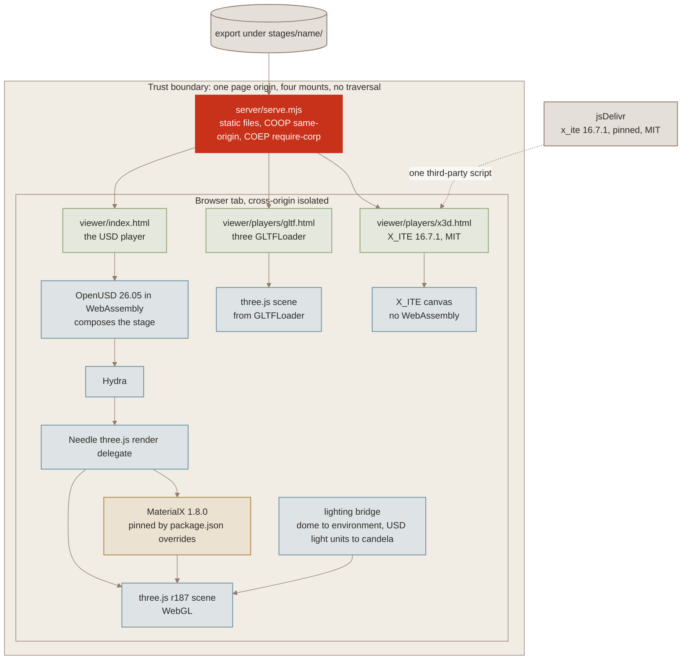

# Architecture

This page explains how a Solaris stage ends up as pixels in a browser tab, from first principles. Read it once before changing the viewer or the server.

## The one idea

**three.js becomes another Hydra render delegate.** A Solaris LOP network produces a USD stage. Karma and the Solaris viewport never read your nodes; they read that stage through Hydra, USD's rendering layer. Hydra splits scene description from drawing: it hands prims to a *render delegate*, and the delegate turns them into pixels.

Needle compiled OpenUSD 26.05 to WebAssembly and wrote a render delegate that outputs three.js objects. So the browser runs the same composition engine Houdini does, and three.js sits where Karma or Storm would. Payloads, variants, purpose and instancing are resolved by real USD, not by a converter that guesses.

## The browser side

The export side ends at one folder under `stages/`. From there the browser side starts: the server, the WebAssembly runtime, and the three players.

## The layers, one at a time

**The export.** The Web Export LOP, or a USD ROP on its own, writes the root layer, every payload and every texture into one folder with relative paths. The browser can only fetch what sits under the server's root, so an absolute `D:/textures/wood.png` is unreachable by design. `tools/web_census.py` checks this before you open the page; see [census.md](census.md).

**The server.** `server/serve.mjs` is a static file server with one job beyond serving files: it sends `Cross-Origin-Opener-Policy: same-origin` and `Cross-Origin-Embedder-Policy: require-corp` on every response. Those two headers make the page *cross-origin isolated*, and only an isolated page may use `SharedArrayBuffer`. The OpenUSD build is threaded, and its threads share memory through `SharedArrayBuffer`, so without the headers the runtime refuses to start. Any host you deploy to must send the same two headers. The server also maps four roots: `/` to `viewer/`, `/vendor/` to `node_modules/`, `/fixtures/` to the test stages and `/stages/` to your exports. It rejects paths that escape those roots and sends `Cache-Control: no-store` so a re-export is never hidden by a stale cache.

**The import map.** `viewer/index.html` builds an import map instead of using a bundler. The page imports `three`, `@needle-tools/usd` and `@needle-tools/materialx` by name, and the map points those names at `/vendor/`. That keeps the source you edit identical to the code the browser runs, and it lets `?three=185` swap the whole three.js version by changing one map entry.

**The runtime.** `getUsdModule()` boots the WebAssembly OpenUSD. `createThreeHydra()` opens the root layer by URL, and USD fetches payloads and sublayers over HTTP as composition asks for them. The delegate creates meshes, instanced meshes for `PointInstancer`, lights and cameras under a `THREE.Group`, and it keeps them in sync when the stage changes. `editStage()` gives you the real `Usd.Stage` API inside a callback, which is how the viewer reads lights and variant sets and how it switches variants.

**Materials.** UsdPreviewSurface maps to three.js physical materials directly. MaterialX networks (`standard_surface`, OpenPBR) go through Needle's MaterialX package, which generates GLSL that three.js compiles. MaterialX is the pinned part of the stack; [versions.md](versions.md) explains why the repo overrides it to 1.8.0.

**The lighting bridge.** The delegate creates three.js lights, but USD and three.js measure light differently, and the delegate leaves dome lights alone. `viewer/main.js` closes that gap: the dome's `.hdr` becomes a prefiltered environment map, and each area light's intensity is converted to the luminous intensity three.js expects. The arithmetic is in [lighting.md](lighting.md).

**The camera.** If the stage has a USD camera, the viewer looks through it and widens the vertical field of view on narrow screens so the authored frame stays fully visible, phone portrait included. The orbit button hands control to `OrbitControls`.

## Three players, and two routes in the main one

The main viewer carries two routes on purpose. The Hydra route is the one described above. The JS route loads a flattened `.usdz` with three.js's own `USDLoader`, which is MIT-licensed and needs no WebAssembly, but it ignores `purpose`, builds only UsdPreviewSurface materials and does no composition of its own. Keeping both on one page shows exactly what the heavy runtime buys you.

Two standalone players sit beside the viewer. `viewer/players/gltf.html` draws the exported `.glb` with three's `GLTFLoader`, and `viewer/players/x3d.html` draws the exported `.x3d` with X_ITE 16.7.1. Neither needs the Needle runtime, and each loads what the exporter produces.

## What is verified, and what is not

Verified in headless Chromium with software rendering, on the synthetic fixture stage: payloads over HTTP, live variant switching, purpose toggling, `PointInstancer`, OpenSubdiv refinement, the USD camera with phone framing, MaterialX `standard_surface` and OpenPBR, UsdPreviewSurface and time samples. Both standalone players load the exporter's own `.glb` and `.x3d` with zero errors. `npm run test:browser` repeats those checks.

Verified since then: Joe's RTX 4090 under Windows (T02, see [CHANGELOG](../CHANGELOG.md) 0.1.2), and live calls to Jev (2026-11-11, through the build router and `tools/decide.py`). Not yet verified: a real Karma export, task T03 in [`plan/tasks.json`](../plan/tasks.json).
