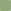
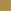
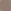
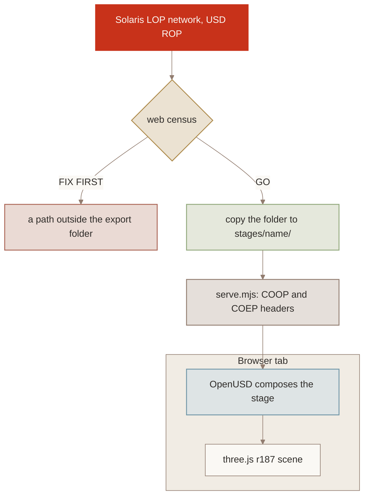

# Mermaid theme

A Mermaid diagram in this repo takes the house style from two pastes: the `%%{init}%%` line below as its first line, and the six `classDef` lines as its last lines. Nodes are opaque paper cards with umber hairlines and dark text, so a diagram looks the same, and stays readable, on GitHub's light and dark backgrounds.

---

###  Paste the two blocks

01. Put the init line first, above `flowchart`. It sets the base theme, the house colours and a system sans font. Mermaid silently empties any theme value that holds a hyphen, so the font list names real fonts and has no `system-ui` or `sans-serif`.

```text
%%{init: {"theme": "base", "themeVariables": {"fontFamily": "Archivo, BlinkMacSystemFont, Segoe UI, Roboto, Helvetica Neue, Helvetica, Arial, Noto Sans, Liberation Sans, DejaVu Sans", "fontSize": "16px", "primaryColor": "#FAF8F4", "primaryTextColor": "#2E2B28", "primaryBorderColor": "#927D70", "secondaryColor": "#F1ECE4", "tertiaryColor": "#F1ECE4", "lineColor": "#927D70", "arrowheadColor": "#927D70", "textColor": "#83776D", "nodeTextColor": "#2E2B28", "clusterBkg": "#F1ECE4", "clusterBorder": "#927D70", "titleColor": "#2E2B28", "edgeLabelBackground": "#FAF8F4", "noteBkgColor": "#F1ECE4", "noteTextColor": "#2E2B28", "noteBorderColor": "#927D70"}}}%%
```

02. Put the class lines last. A node takes a class with `node:::stone` or `class a,b stone`.

```text
  classDef stone fill:#DEE4E5,stroke:#7096A7,stroke-width:1.5px,color:#2E2B28
  classDef moss fill:#E5E8DC,stroke:#91A87B,stroke-width:1.5px,color:#2E2B28
  classDef ochre fill:#EBE2D2,stroke:#AE8B4C,stroke-width:1.5px,color:#2E2B28
  classDef clay fill:#EADAD4,stroke:#AA6455,stroke-width:1.5px,color:#2E2B28
  classDef umber fill:#E5DFDA,stroke:#927D70,stroke-width:1.5px,color:#2E2B28
  classDef accent fill:#C8321A,stroke:#C8321A,stroke-width:1.5px,color:#FAF8F4
```

---

###  Tag only the nodes whose role helps

Most nodes need no class. Tag a node when its role is the thing the reader should notice, and give **the accent to exactly one node per diagram**: the place to start reading.

| Class | Role | Give it to |
|---|---|---|
| `stone` | Concept | What something is or how it works |
| `moss` | Action | A step or command the reader runs |
| `ochre` | Decision | A gate or a choice, such as the census verdict |
| `clay` | Risk | A failure, a blocker or a warning |
| `umber` | Reference | Files, specs, data and sources |
| `accent` | Start here | One node, where the reader begins |

Each role class tints the paper card with its swatch and draws the swatch as the border. The text stays dark, so the role colour never carries the meaning alone; the label does.

---

###  Why one palette works on both backgrounds

GitHub draws a diagram on white in light mode and on `#0D1117` in dark mode, and a fixed theme cannot switch between them. So everything that holds text is opaque: node, cluster and edge-label text is `#2E2B28` on paper, at 10:1 or more. Lines and borders are umber `#927D70`, which keeps 3.9:1 against white and 4.9:1 against `#0D1117`. The few labels drawn straight on the page use `#83776D`, which holds 4.3:1 on both. The accent card is paper text on vermilion `#C8321A`, at 5.0:1.

---

###  Example



One init line first, six class lines last and the accent on one node: that is the whole theme.
